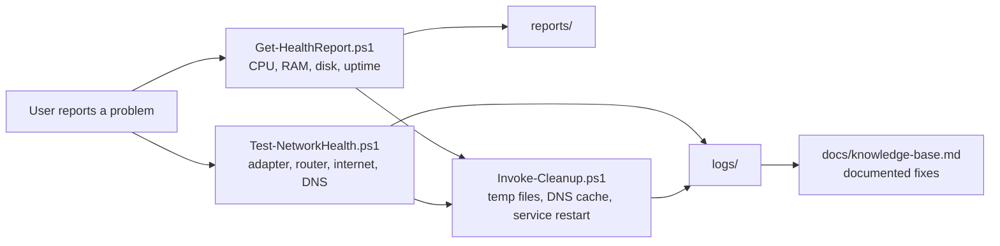

# Windows IT Support Toolkit

A set of PowerShell tools that diagnose and fix common Windows and network problems, with a knowledge base of step-by-step resolutions. Built to automate the checks an IT support engineer repeats every day.

**Author:** Sanjana Tej

## Problem
When a user reports "my PC is slow" or "the internet isn't working", support engineers run the same checks by hand each time. This toolkit automates those checks, produces a clear diagnosis, applies safe fixes, and logs every action.

## Tools

| Script | What it does |
|---|---|
| `scripts/Get-HealthReport.ps1` | Reports CPU load, RAM, disk usage, uptime and top 5 memory-hungry processes. Flags values above thresholds and saves a timestamped report. |
| `scripts/Test-NetworkHealth.ps1` | Checks adapter, router, internet and DNS in order, then prints a plain-English diagnosis and logs it. |
| `scripts/Invoke-Cleanup.ps1` | Removes old temp files, flushes the DNS cache and can restart a service. Supports `-WhatIf` (dry run) and logs every action. |
| `docs/knowledge-base.md` | 10 common issues with symptom, cause, diagnosis, fix and prevention. |

## How It Works



## Requirements
- Windows 10 or 11 with PowerShell 5.1 (built in) or PowerShell 7
- Administrator rights only for restarting services

## Usage

Open PowerShell in the project folder and allow scripts for this session only:
```powershell
Set-ExecutionPolicy -Scope Process -ExecutionPolicy Bypass
```

**1. Health report**
```powershell
.\scripts\Get-HealthReport.ps1
```

**2. Network diagnosis**
```powershell
.\scripts\Test-NetworkHealth.ps1
```
Safe fault simulations (no system settings are changed):
```powershell
# Simulate a DNS failure
.\scripts\Test-NetworkHealth.ps1 -DnsTestName "this-name-does-not-exist.invalid"

# Simulate "router works, internet does not"
.\scripts\Test-NetworkHealth.ps1 -InternetTarget "10.255.255.1"
```

**3. Cleanup and fix**
```powershell
.\scripts\Invoke-Cleanup.ps1 -WhatIf              # preview only
.\scripts\Invoke-Cleanup.ps1                      # run it
.\scripts\Invoke-Cleanup.ps1 -ServiceName Spooler # also restart a service (run as Administrator)
```

## Screenshots

Add your own screenshots to the `screenshots/` folder and link them here:

| Health report | Network diagnosis (healthy) | Network diagnosis (simulated fault) | Cleanup dry run |
|---|---|---|---|
| `screenshots/01-health.png` | `screenshots/02-network-ok.png` | `screenshots/03-network-fault.png` | `screenshots/04-cleanup-whatif.png` |

## Tests Performed

| # | Test | Expected | Result |
|---|---|---|---|
| 1 | Run health report | Report shown and saved in `reports/` | |
| 2 | Network check on a working connection | All PASS, "network looks healthy" | |
| 3 | Network check with an invalid DNS name | DNS FAIL, diagnosis points to DNS | |
| 4 | Network check with an unreachable internet target | Internet FAIL, router PASS | |
| 5 | Cleanup with `-WhatIf` | Lists actions, deletes nothing | |
| 6 | Cleanup without `-WhatIf` | Old temp files removed, DNS flushed, log written | |
| 7 | Restart the Spooler service as Administrator | Status shows Running | |

(Fill in the Result column from your own runs.)

## Project Structure
```
windows-support-toolkit/
  README.md
  scripts/
    Get-HealthReport.ps1
    Test-NetworkHealth.ps1
    Invoke-Cleanup.ps1
  docs/
    knowledge-base.md
  reports/
  logs/
  screenshots/
```

## Limitations
- Some networks (for example campus or corporate) block ping, so the router or internet check can fail even when browsing works.
- Restarting services needs Administrator rights.
- Tested on Windows 11. Update the line below with what you actually tested.

**Tested on:** Windows 11, PowerShell 5.1

## Skills Demonstrated
PowerShell scripting, Windows administration, network troubleshooting (adapter, gateway, DNS), logging and safe automation (`-WhatIf`), technical documentation and knowledge-base writing.
